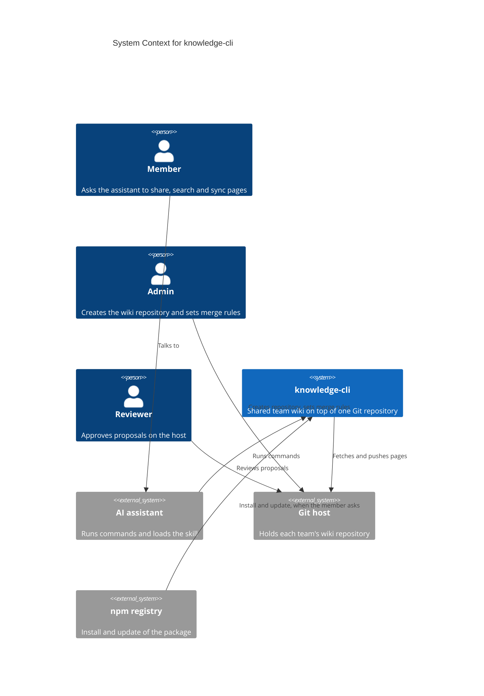
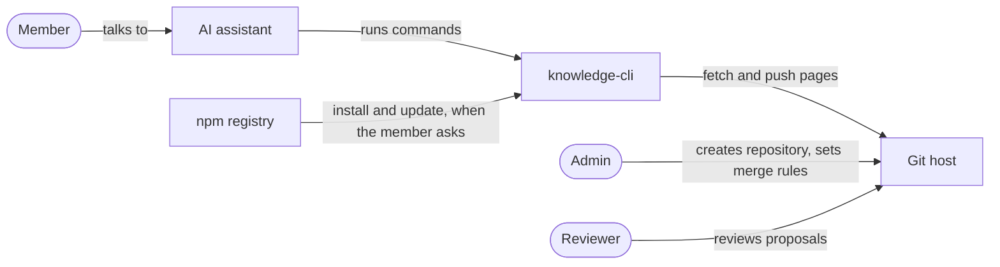
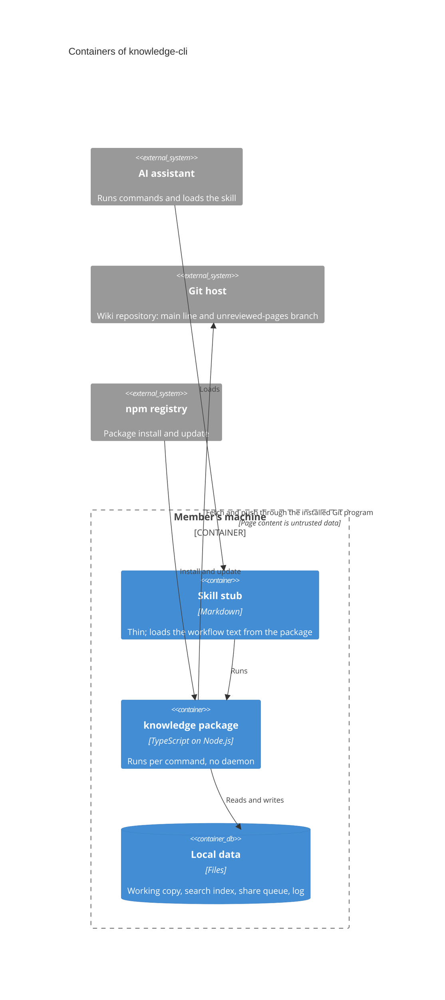
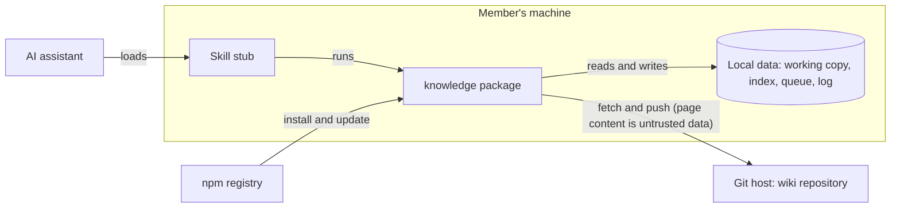
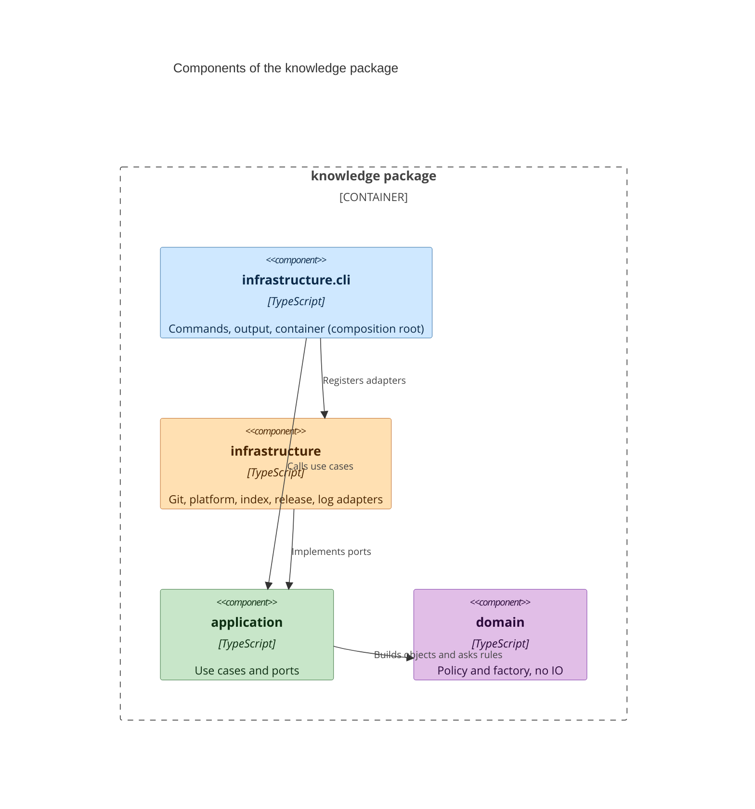
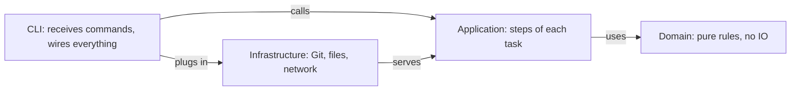
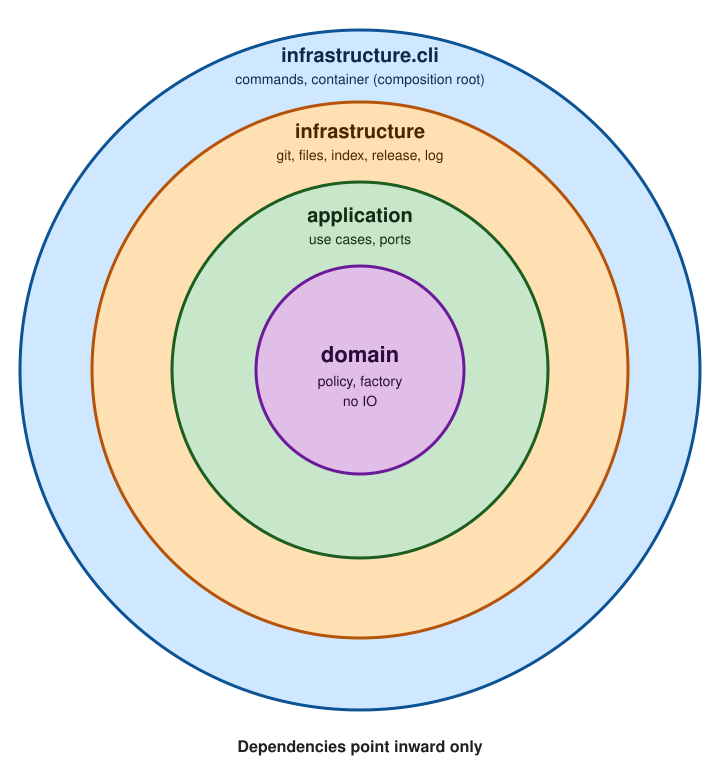
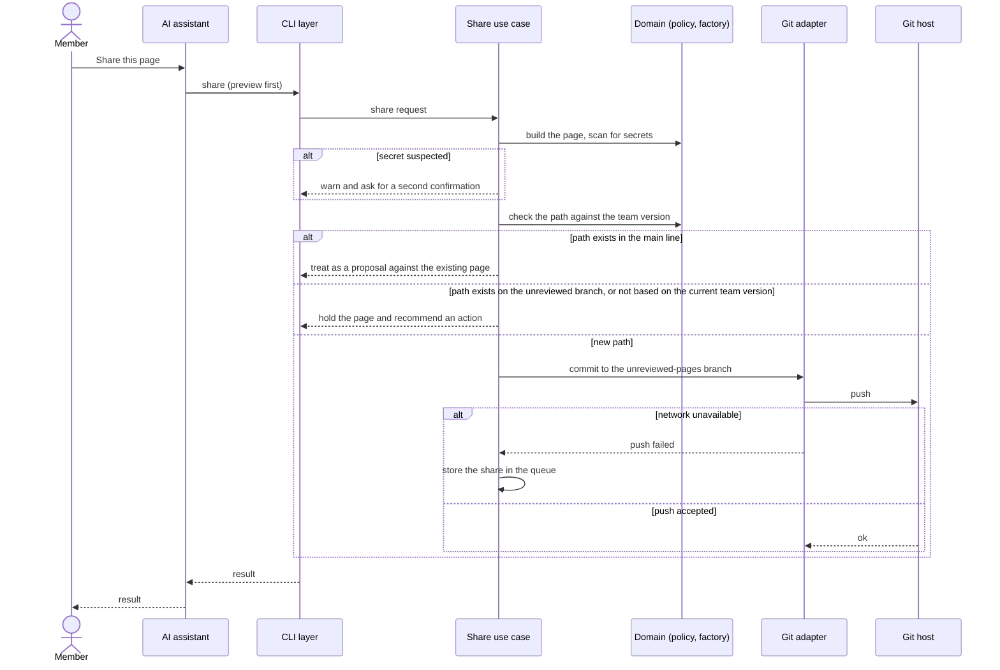
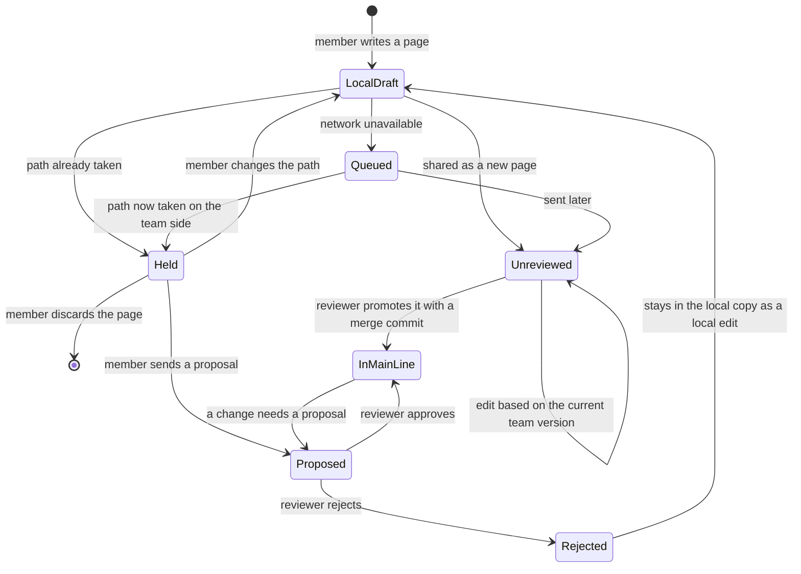
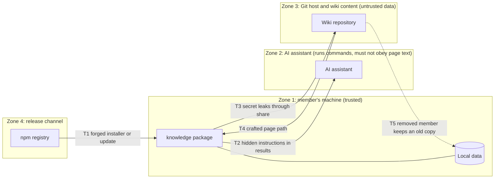

# Diagram Drafts

**Status**: Temporary working file. These drafts follow decision D-039 and have **not been rendered or checked yet**. Open this file in a Mermaid renderer (GitHub preview or an editor) and check each diagram. When the real documents in `architecture/` are written (tasks T011, T012, T015, T017, T020, T036), move each diagram there and delete this file.

Labels are in English. Names of files and folders are examples only.

## 1. C4 Context (goes to business-architecture.md)

Fallback (flowchart)

Caption: knowledge-cli touches three things outside itself: the AI assistant that runs its commands, the Git host that holds the wiki, and the npm registry at install and update. It sends no usage data anywhere.

## 2. C4 Container (goes to system-architecture.md, Parts)

Fallback (flowchart)

Caption: Everything inside the member's machine can be rebuilt or sent again. The wiki repository on the Git host is the only source of truth.

## 3. C4 Component (goes to project-structure.md)

Fallback (flowchart)

Caption: Dependencies point inward only. The domain knows no other layer. Only infrastructure.cli registers adapters in the container.

## 4. Sequence: share a page (goes to system-architecture.md, Data flows)

Caption: A new page reaches the team without review. A page whose path is taken is held or sent as a proposal and never renamed. A failed push goes to the queue and is retried at the next command.

## 5. State: a wiki page (goes to business-architecture.md, Business rules)

Caption: Only reviewers move a page into the main line. A rejected proposal never deletes the member's version.

## 6. Trust zones (goes to system-architecture.md and threat-model.md)

Caption: Threats T1 to T5 are the first five of D-018. Page content and search results cross into the assistant as data, never as instructions (D-013).
